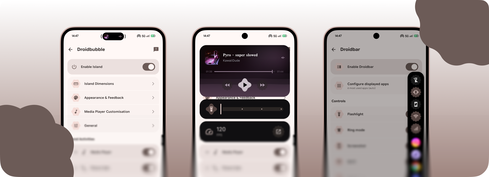

  
  

# Androidisland

  
  
  
  

---

Bộ công cụ hiển thị nổi (overlay) dành cho Android. Được xây dựng gốc bằng Kotlin, Jetpack Compose và Material 3.
Phát triển bởi **digitalxiao**.

Các tính năng chính:

- **Androidisland**: Đảo động (Dynamic Island) bao quanh cụm camera trước của bạn.
- **Droidbar**: Thanh công cụ nhỏ gọn ở cạnh phải màn hình để bật/tắt nhanh và mở ứng dụng.
- **Tác vụ (Tasks)**: Chuỗi phím tắt hành động nhanh hiển thị phản hồi trực tiếp trên đảo động.

Hoàn toàn miễn phí, mã nguồn mở, không quảng cáo và không theo dõi dữ liệu ngầm.

---

## Androidisland

Đảo động thông minh cho Android. Nằm gọn trong vùng khuyết camera và bung ra mượt mà khi có hoạt động mới.

- **Đang phát nhạc**: Hiển thị ảnh bìa album, tên bài hát, thanh tua nhạc và nút điều khiển với nền làm mờ theo màu ảnh bìa.
- **Sự kiện hệ thống**: Hiển thị công suất sạc (W), thay đổi chế độ chuông, kết nối Bluetooth, mở khóa và nhiều trạng thái khác theo thời gian thực.
- **Thông báo**: Thông báo nổi có thể mở rộng và trả lời nhanh ngay trên đảo mà không cần mở ứng dụng.
- **Trạng thái chờ**: Khi không có hoạt động, đảo tự động thu gọn vào vùng khuyết camera.
- **Tùy biến linh hoạt**: Điều chỉnh vị trí, kích thước, độ nảy lò xo, phông chữ và thứ tự các lớp bố cục.

## Droidbar

Thanh bên mỏng nhẹ nằm ở cạnh phải màn hình. Chạm để mở, chạm lần nữa để đóng.

- **Điều khiển nhanh**: Đèn pin, chuông/rung, Wi-Fi, dữ liệu di động và chụp màn hình.
- **Ứng dụng**: Mở nhanh các ứng dụng dùng nhiều nhất hoặc ghim ứng dụng yêu thích của riêng bạn.
- Giao diện tối cùng hiệu ứng chuyển động đàn hồi và phản hồi xúc giác mượt mà.

---

## Yêu cầu hệ thống

- Android 13 trở lên (tối thiểu Android 10 / SDK 29)
- Một số quyền cần thiết cho ứng dụng hiển thị nổi:
  - **Hiển thị trên các ứng dụng khác**: Để vẽ giao diện đảo động lên trên màn hình
  - **Dịch vụ Trợ năng (Accessibility)**: Để nhận thao tác chạm trên thanh trạng thái và chụp màn hình
  - **Truy cập thông báo**: Để đọc thông tin nhạc đang phát và hiển thị thông báo đến

Mọi dữ liệu đều được xử lý cục bộ trên điện thoại của bạn.

---

## Tác giả & Giấy phép

- **Tác giả**: digitalxiao
- **Giấy phép**: MIT. Xem chi tiết tại [LICENSE](LICENSE).
